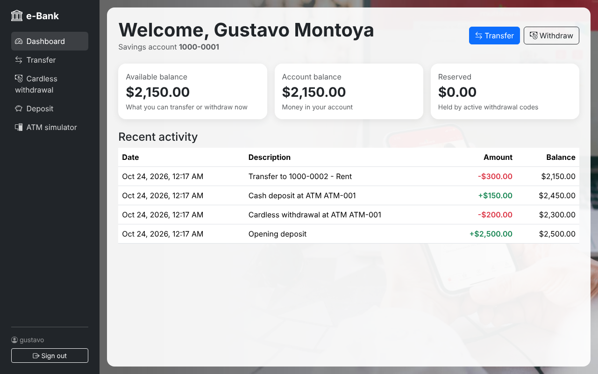
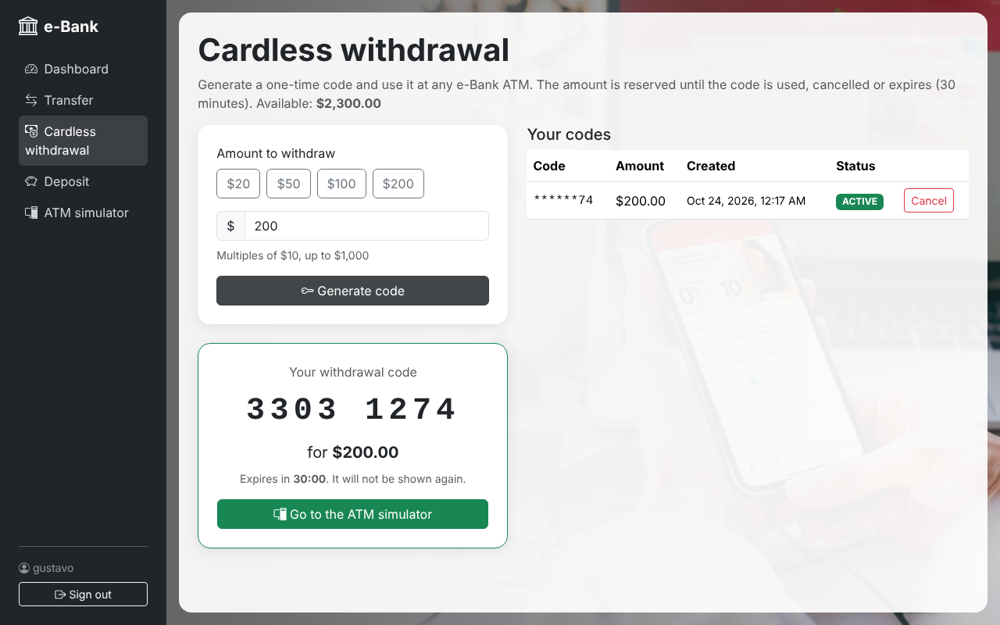
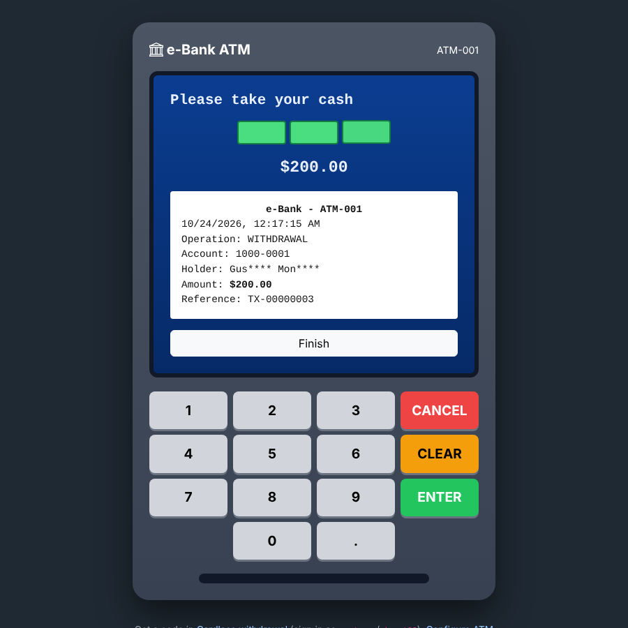
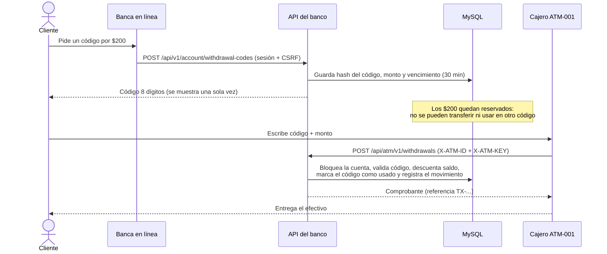

# e-Bank

Banca en línea de demostración hecha con **Spring Boot 3 + Java 21**: cuentas, transferencias, depósitos en
efectivo por cajero y **retiro sin tarjeta con código de un solo uso**, más un **simulador de cajero automático**
que consume la API del banco como lo haría una máquina real.



## Probar la demo

Solo necesitas [Docker Desktop](https://www.docker.com/products/docker-desktop/). No hace falta instalar Java, Maven ni MySQL.

```bash
docker compose up --build
```

Abre http://localhost:8080. La primera vez se crean usuarios de prueba:

| Usuario | Contraseña | Rol | Cuenta |
|---|---|---|---|
| `gustavo` | `demo123` | Cliente | `1000-0001` ($2,500) |
| `maria` | `demo123` | Cliente | `1000-0002` ($1,200) |
| `admin` | `admin123` | Administrador | - |

Cajero de prueba: **ATM-001** con la llave `demo-atm-key-001` (el simulador ya la trae escrita).

### Recorrido sugerido

1. Entra como `gustavo`. En **Cardless withdrawal** genera un código por $200.
   El saldo disponible baja $200 (queda *reservado*), pero el dinero sigue en la cuenta.
2. Abre el **ATM simulator** (http://localhost:8080/atm), elige *Cardless withdrawal*,
   escribe el código y el monto. El cajero "entrega" el efectivo y el retiro aparece en el historial.
3. Intenta usar el mismo código otra vez: el cajero lo rechaza.
4. En el cajero elige *Cash deposit*, escribe la cuenta `1000-0002`, inserta billetes y confirma.
5. Desde la web de `gustavo`, transfiere dinero a `1000-0002`. Entra como `maria` y verás ambos movimientos.
6. Entra como `admin` para ver todas las cuentas.

| Retiro sin tarjeta | Simulador de cajero |
|---|---|
|  |  |

## Cómo funciona

En un banco real no existe un botón de "depositar" que te sume dinero: el dinero entra por un cajero, una
sucursal o una transferencia. Por eso la demo separa dos clientes de la API:

- **Banca en línea** (`/api/v1/account/**`): el cliente inicia sesión con usuario y contraseña.
  Puede ver su cuenta, transferir y generar códigos de retiro. **No puede crear dinero.**
- **Red de cajeros** (`/api/atm/v1/**`): cada cajero se autentica con su propia llave (headers `X-ATM-ID` y `X-ATM-KEY`).
  Es el único que puede recibir efectivo (depósito) o entregarlo (cobrar un código).

### Retiro sin tarjeta



Reglas del código:

- 8 dígitos generados con `SecureRandom`. En la base solo se guarda su **hash SHA-256** y los 2 últimos dígitos (para que el cliente lo reconozca).
- Vence a los 30 minutos (`bank.withdrawal-code.ttl-minutes`), se usa **una sola vez** y el cliente puede cancelarlo.
- El cajero debe enviar el **monto exacto**. Ante cualquier fallo responde siempre el mismo mensaje, para no revelar si un código existe.
- Montos múltiplos de $10 (los cajeros entregan billetes), máximo $1,000.

### Integridad del dinero

- Cada operación corre en una transacción y **bloquea la fila de la cuenta** (`SELECT ... FOR UPDATE`), así dos
  operaciones simultáneas no pueden gastar el mismo saldo. En las transferencias las cuentas se bloquean siempre
  en el mismo orden, para evitar *deadlocks*.
- Saldo disponible = saldo − montos reservados por códigos activos.
- Cada movimiento queda en `transaction` con el saldo resultante, como un estado de cuenta.
  La API no permite crear, editar ni borrar movimientos a mano.
- El administrador puede ver cuentas pero **no cambiar saldos**: el dinero solo se mueve con operaciones.

### Seguridad

- Spring Security con login por formulario, contraseñas cifradas con **BCrypt** y protección **CSRF**.
- Roles: `CUSTOMER` (tiene cuenta), `ADMIN` (está en la tabla `administrator`) y `ATM` (cajeros).
- Las APIs de administración (`/api/v1/customers`, `/people`, etc.) solo responden a `ADMIN`.
- Las respuestas JSON nunca incluyen contraseñas, hashes de códigos ni llaves de cajeros.

### Estructura

```
src/main/java/com/kodigo/bank
├── config/        DemoDataInitializer (usuarios y cajeros de prueba)
├── controller/    AccountController (banca en línea), AtmController (cajeros), CRUD de administración, páginas
├── dto/           Peticiones y respuestas de la API (records con validación)
├── entity/        Entidades JPA
├── exception/     Errores de negocio y formato común {"error": "..."}
├── repository/    Spring Data JPA
├── security/      SecurityConfig, login con BCrypt, autenticación de cajeros
└── service/       AccountService (transferencias, códigos), AtmService (retiros, depósitos)
src/main/resources
├── db/migration/  Esquema de la base con Flyway
└── templates/     Thymeleaf: banca en línea, panel admin, simulador de cajero (atm.html)
```

## API

**Banca en línea** (requiere sesión de cliente y token CSRF):

| Método | Ruta | Descripción |
|---|---|---|
| GET | `/api/v1/account` | Cuenta, saldo, reservado y disponible |
| GET | `/api/v1/account/transactions` | Últimos 50 movimientos |
| POST | `/api/v1/account/transfers` | `{"toAccountNumber","amount","description"}` |
| GET | `/api/v1/account/withdrawal-codes` | Códigos generados (sin el código completo) |
| POST | `/api/v1/account/withdrawal-codes` | `{"amount"}`: genera un código |
| DELETE | `/api/v1/account/withdrawal-codes/{id}` | Cancela un código activo |

**Cajeros** (headers `X-ATM-ID` y `X-ATM-KEY`):

| Método | Ruta | Descripción |
|---|---|---|
| GET | `/api/atm/v1/accounts/{accountNumber}` | Titular con el nombre enmascarado (para confirmar un depósito) |
| POST | `/api/atm/v1/withdrawals` | `{"code","amount"}`: cobra un código y devuelve el comprobante |
| POST | `/api/atm/v1/deposits` | `{"accountNumber","amount"}`: depósito en efectivo |

Ejemplo:

```bash
curl -X POST http://localhost:8080/api/atm/v1/deposits \
  -H "X-ATM-ID: ATM-001" -H "X-ATM-KEY: demo-atm-key-001" \
  -H "Content-Type: application/json" -d '{"accountNumber":"1000-0002","amount":100}'
```

Los errores siempre llegan como `{"error": "mensaje"}` con código 400, 401, 403 o 404.

## Desarrollo

| Qué quieres hacer | Comando |
|---|---|
| Correr los tests (usan H2 en memoria, no necesitan Docker) | `./mvnw test` |
| Arrancar en segundo plano | `docker compose up -d --build` |
| Ver los logs de la app | `docker compose logs -f app` |
| Apagar | `docker compose down` |
| Borrar la base y empezar de cero | `docker compose down -v` |
| Entrar a MySQL | `docker compose exec db mysql -uroot -p1407 bank_management` |

MySQL queda disponible desde tu PC (MySQL Workbench, DBeaver) en `localhost:3307`, usuario `root`, contraseña `1407`.

Sin Docker necesitas Java 21 y un MySQL 8 con una base vacía `bank_management`; las tablas las crea Flyway al arrancar:

```bash
DB_URL=jdbc:mysql://localhost:3306/bank_management DB_USERNAME=root DB_PASSWORD=1407 ./mvnw spring-boot:run
```

## Historia del proyecto

### 2024: proyecto original (equipo Kodigo)

Hecho a mano por **Gustavo Montoya** ([@gxmonto](https://github.com/gxmonto)) con aportes de **fleitasj** (rama `Gregorio`):

- Proyecto Spring Boot con las entidades `People`, `Customer`, `Bank`, `BankLoan`, `LoanPayment`, y su API CRUD (controller, service, repository).
- `Administrator`, `Transaction` y `CreditCard` (fleitasj), y `CardPayment`.
- Modelo de la base en MySQL Workbench y script SQL (hoy en [`docs/legacy/`](docs/legacy)).
- Frontend con Bootstrap: login, dashboard, préstamos, tarjetas, depósito y retiro.
- Integración con Thymeleaf, **login validado contra la base de datos** y consulta del saldo real de la cuenta.
- Endpoint de depósito en el backend.

**Hasta ahí llegó:** el login y el saldo funcionaban, pero el depósito y el retiro solo cambiaban el número en la
página y nunca llegaban a la base. La página de depósito no llamaba al endpoint, la de retiro solo mostraba un
`alert`, y el id del cliente se perdía porque `index.html` usaba sintaxis de JSP (`<%= %>`) que Thymeleaf no entiende.

### 2026: continuación con [Claude Code](https://claude.com/claude-code)

1. **Diagnóstico y arreglo** del depósito y retiro: la sesión guarda al usuario y las páginas llaman a la API.
2. **Docker**: `Dockerfile` + `docker-compose.yml` para levantar todo con un comando.
3. **Rediseño a un modelo bancario realista:**
   - Spring Security con BCrypt, CSRF y roles; APIs de administración cerradas (antes cualquiera podía cambiar un saldo).
   - Transferencias entre cuentas, depósito en efectivo por cajero y retiro sin tarjeta con código de un solo uso.
   - API para cajeros con autenticación por llave, y simulador de cajero.
   - Bloqueo de filas, saldo reservado, historial inmutable con saldo resultante.
   - Esquema limpio con Flyway (el original tenía tablas duplicadas) y datos de demostración.
   - Frontend nuevo con fragmentos de Thymeleaf, y 23 tests de integración (incluye pruebas de concurrencia).

## Pendiente

- **Préstamos y tarjetas**: las páginas de 2024 siguen en el panel de administración pero no están terminadas
  (no mueven dinero y no están ligadas a un cliente). Es el siguiente módulo natural.
- Límite de intentos fallidos por cajero (hoy un código de 8 dígitos + monto exacto es la protección).
- Registro de clientes y apertura de cuentas desde la web.
- Notificaciones (por ejemplo, enviar el código por SMS o correo en vez de mostrarlo en pantalla).
